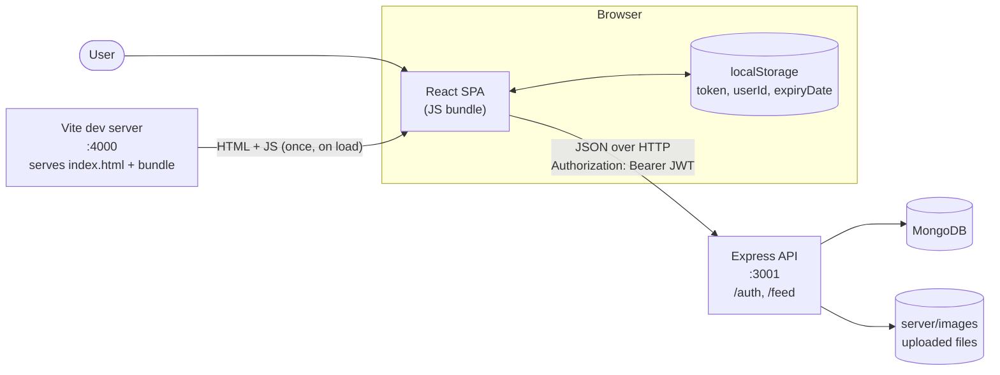
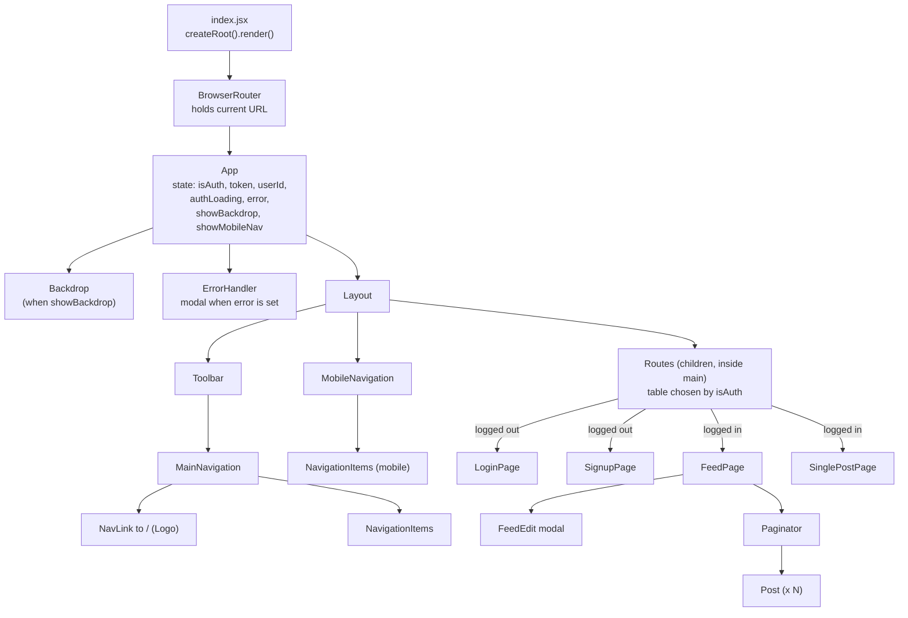
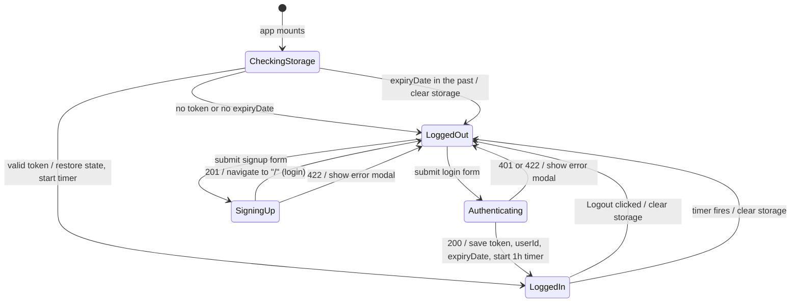
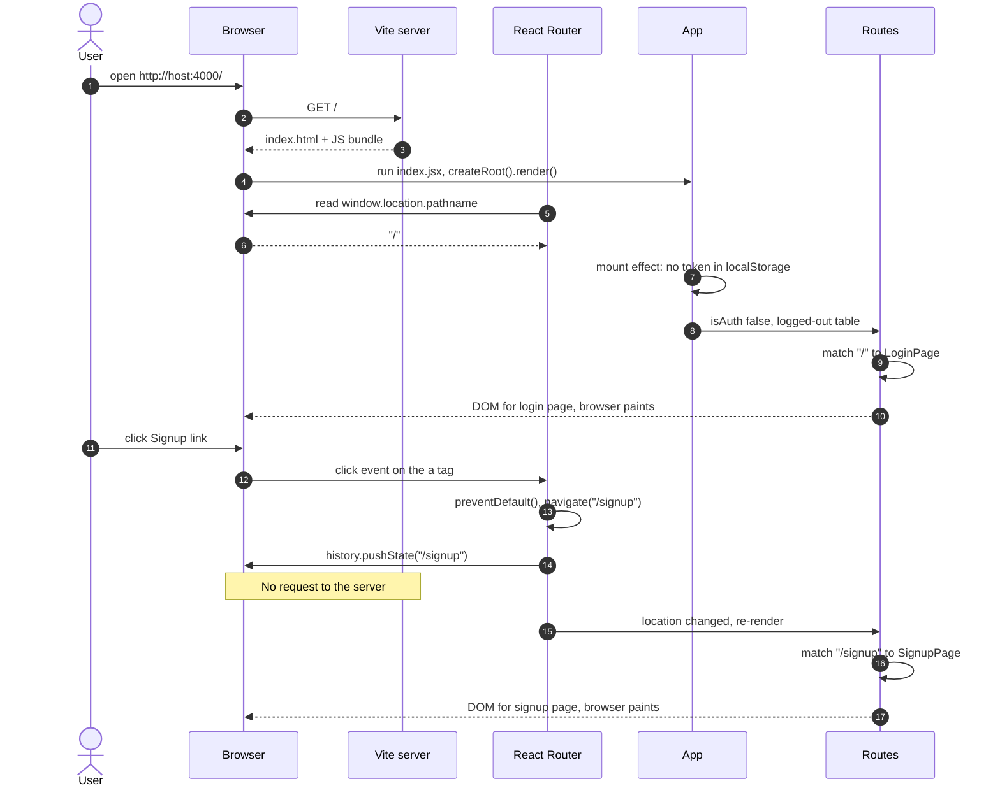
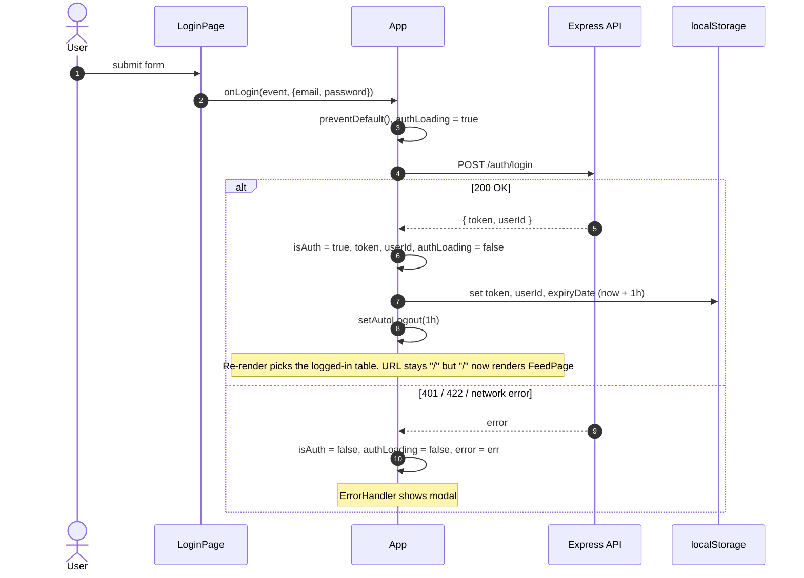
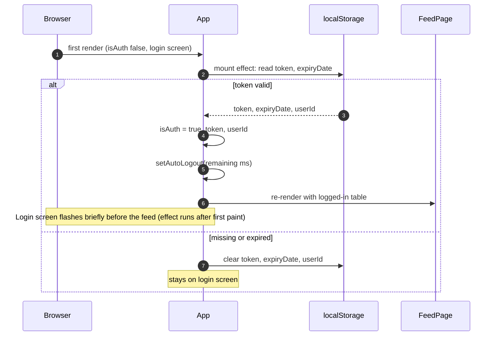
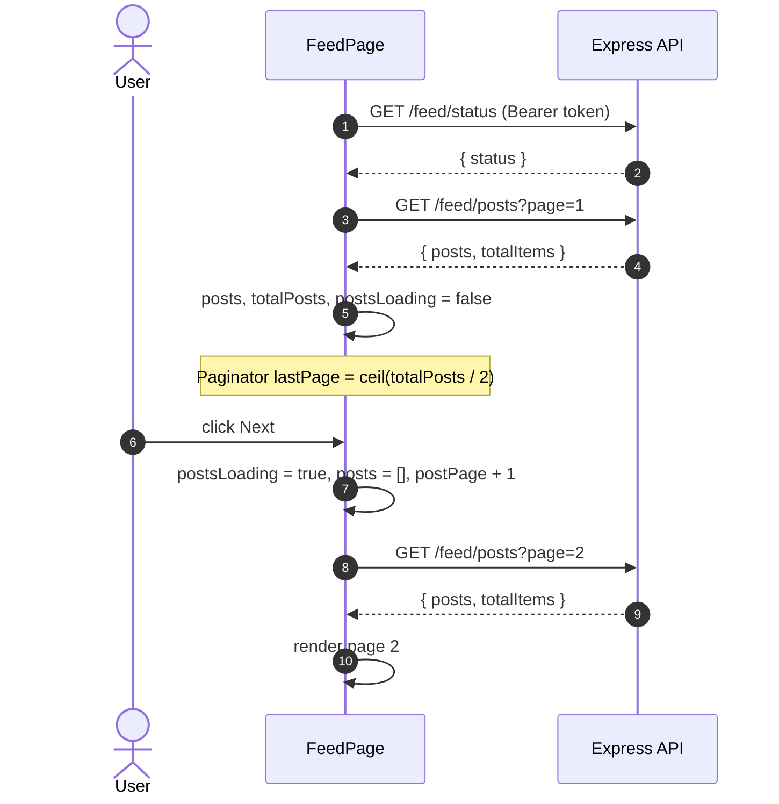
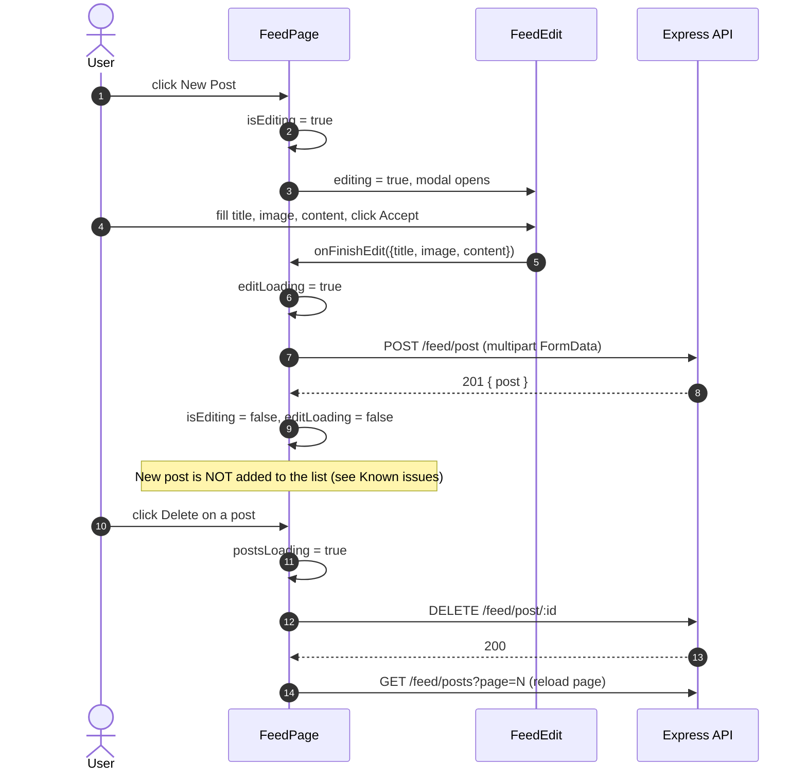
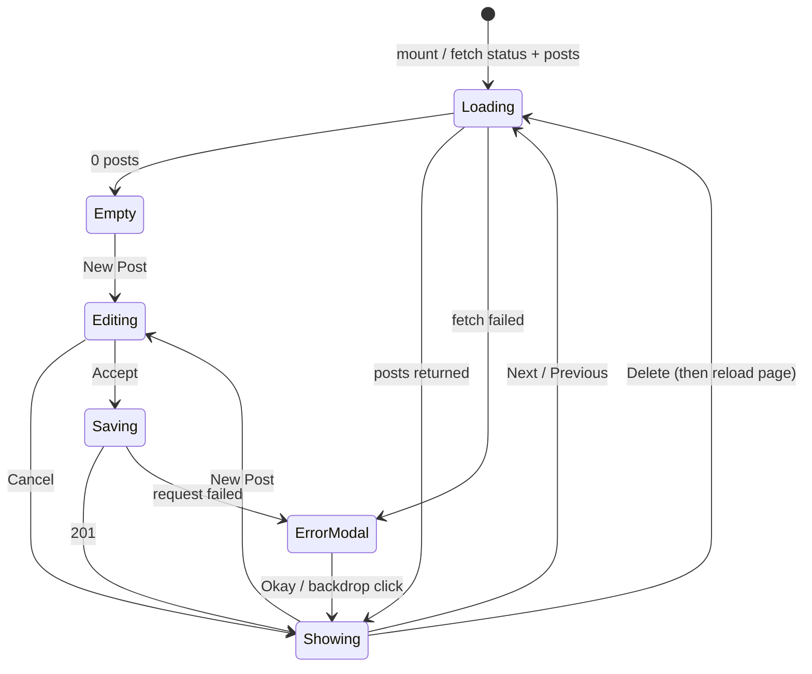

# Frontend Architecture — Sociam_media client

| | |
|---|---|
| **Scope** | React client (`client/`) and how it talks to the Express API (`server/`) |
| **Stack** | React 19, React Router 7 (declarative mode), Vite 6 dev server, `fetch` for HTTP |
| **Status** | Mid-migration from class components to hooks. Converted: `App`, `SinglePost`, `Login`. Remaining: `Signup`, `Feed`, `FeedEdit`. Gaps are listed in [Known issues](#7-known-issues) |
| **Last updated** | 2026-10-05 |

## Contents

1. [System context](#1-system-context)
2. [Component tree](#2-component-tree)
3. [Route map](#3-route-map)
4. [Auth session state machine](#4-auth-session-state-machine)
5. [Sequence diagrams](#5-sequence-diagrams)
6. [Feed page state machine](#6-feed-page-state-machine)
7. [Known issues](#7-known-issues)

---

## 1. System context

Where the client sits. Ports come from `docker-compose.yml`.

---

## 2. Component tree

What renders inside what. `App` owns auth and UI-chrome state and passes it down as props.

**Props that cross the tree**

| From | To | Props |
|---|---|---|
| `App` | `MainNavigation`, `MobileNavigation` → `NavigationItems` | `isAuth`, `onLogout` (+ `onChoose` for mobile) |
| `App` | `LoginPage` / `SignupPage` | `onLogin` / `onSignup`, `loading` |
| `App` | `FeedPage`, `SinglePostPage` | `token`, `userId` |
| `FeedPage` | `FeedEdit` | `editing`, `selectedPost`, `loading`, `onCancelEdit`, `onFinishEdit` |
| `FeedPage` | `Post` | `id`, `author`, `date`, `title`, `onDelete` |

---

## 3. Route map

Frontend route → screen → backend calls it makes. Two route tables exist; `isAuth` picks one.

| Table | Path | Renders | API calls on mount | API calls from user actions |
|---|---|---|---|---|
| Logged out | `/` | `LoginPage` | none | `POST /auth/login` |
| Logged out | `/signup` | `SignupPage` | none | `PUT /auth/signup` |
| Logged out | `*` | `Navigate` → `/` | — | — |
| Logged in | `/` | `FeedPage` | `GET /feed/status`, `GET /feed/posts?page=1` | `PUT /feed/status`, `POST /feed/post`, `DELETE /feed/post/:id`, `GET /feed/posts?page=N` |
| Logged in | `/:postId` | `SinglePostPage` | `GET /feed/post/:postId` | none |
| Logged in | `*` | `Navigate` → `/` | — | — |

All `/feed/*` calls send `Authorization: Bearer <token>`.

---

## 4. Auth session state machine

The session lives in `App` state and is mirrored to `localStorage` so it survives a reload. The token expires after 1 hour (server `expiresIn: "1h"`, client timer).

| State | `isAuth` | `authLoading` | Route table | Nav links shown |
|---|---|---|---|---|
| CheckingStorage | false | false | logged out | Login, Signup |
| LoggedOut | false | false | logged out | Login, Signup |
| Authenticating / SigningUp | false | true | logged out | Login, Signup (button shows "Loading...") |
| LoggedIn | true | false | logged in | Feed, Logout |

---

## 5. Sequence diagrams

### 5.1 Initial load (logged out) and NavLink click

### 5.2 Login

### 5.3 Session restore on reload

### 5.4 Feed load and pagination

### 5.5 Create and delete a post

---

## 6. Feed page state machine

---

## 7. Known issues

Found while documenting. Ordered by impact.

| # | Area | Issue | Effect |
|---|---|---|---|
| 1 | `SinglePost` | ~~Reads `this.props.match.params` (removed API)~~ | **Fixed 2026-10-05:** converted to a function component using `useParams` |
| 2 | `Feed` create | `POST` success branch never inserts the new post (`addPost` is unused, socket emits are commented out server-side) | New post doesn't appear until reload or page change |
| 3 | `Feed` edit | Edit button commented out in `Post`, `updatePost` is empty | Editing is unreachable |
| 4 | `App` layout | ~~Routes render as a sibling of `Layout`~~ | **Fixed 2026-10-05:** routes passed as `Layout` children, render inside `<main>` |
| 5 | Auth | Bad/expired token returns **500** from `is-auth` middleware instead of 401, and the client has no 401 handling | Server-side expiry shows a generic error instead of logging out |
| 6 | Auth | Auto-logout `setTimeout` is never cleared | Stale timer can fire after a manual logout + new login |
| 7 | Auth | `logoutHandler` doesn't reset `userId` | Stale `userId` in state after logout |
| 8 | Auth | Session restore runs in an effect after first paint | Brief login-page flash on reload when logged in |
| 9 | `Feed` | `socket.io-client` imported but unused | Dead import |
| 11 | `GET /feed/status` | ~~`User.findById` not awaited, so `status` was missing from the response~~ | **Fixed 2026-10-05:** added `await` (caused the controlled-to-uncontrolled input warning) |
| 10 | `NavigationItems` | `NavLink exact` prop (removed in v6+) | Console warning. Use `end` |
